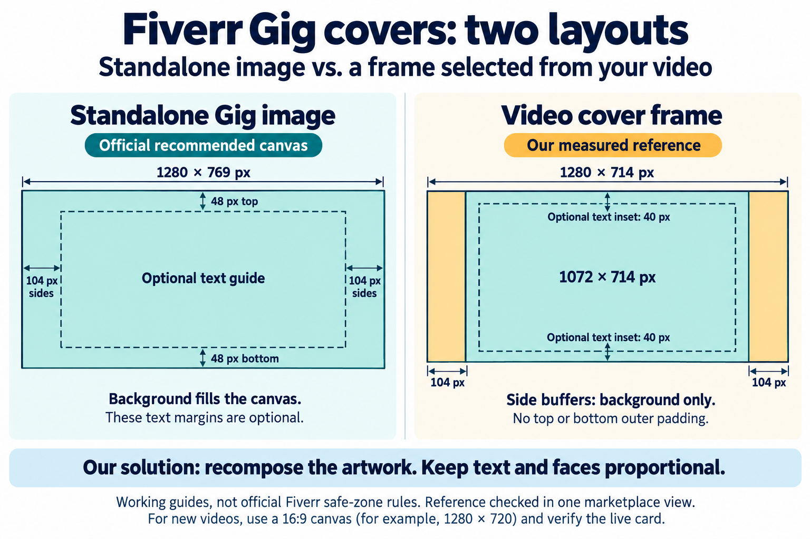

# Fiverr Gig Media

An English Codex skill for preparing Fiverr Gig images and video cover frames with separate compositions, proportional artwork, and clearly labeled safe-area guides.

By [Harun Sekmen](https://github.com/harunsekmen) · [GitHub repository](https://github.com/harunsekmen/fiverr-gig-media)



The comparison is schematic. Use the [exact SVG guides](#editable-guides) for design coordinates.

## Why two layouts?

A standalone Gig image uses Fiverr's recommended **1280 × 769 px** canvas. A video thumbnail is a selected video frame, and Fiverr says it takes priority over the Gig images. The two compositions therefore need separate sizing and working safe-area guides. Sources: [Gig images](https://help.fiverr.com/hc/en-us/articles/15863342952977-Creating-Gig-images-and-tagging-your-Gig-gallery), [Gig video](https://help.fiverr.com/hc/en-us/articles/360010451657-Adding-and-managing-your-Gig-video), [Creating a Gig](https://help.fiverr.com/hc/en-us/articles/360010451397-Creating-a-Gig).

In the original accepted example, the video frame was **1280 × 714 px**, with **104 px of background-only space on each side** and **1072 × 714 px of central artwork**. The artwork filled the height. Recomposition preserved the text and face proportions.

That is a measured workflow example, not an official Fiverr video size or a universal safe zone. For new videos, Fiverr's troubleshooting guide specifies 16:9 and a minimum of 1280 × 720. Applying the reference buffers to a new video still requires a marketplace check. [Source and conflicting upload limits](references/official-specs.md).

## What the guides mean

| Guide | Standalone image | Measured video reference |
|---|---|---|
| Outer canvas | 1280 × 769 | 1280 × 714 |
| Artwork placement | Background fills the entire canvas | Central 1072 × 714 area at x=104, y=0 |
| Side buffers outside the artwork | None | 104 px each; background only |
| Optional text inset | 104 px left/right; 48 px top/bottom | 40 px inside the central artwork |
| Optional text box | x=104, y=48; 1072 × 673 | x=144, y=40; 992 × 634 |

The optional insets are design starting points. The reviewed Fiverr pages do not specify these numeric safe zones. Text should remain readable and clear of visible interface buttons; actual crops and overlays must be checked on the target view.

## Use as a skill

Place this repository folder in your agent's skills directory, with `SKILL.md` at its root. For the standard Codex user-skill location, the result is `~/.codex/skills/fiverr-gig-media/SKILL.md`.

Example requests:

```text
Use $fiverr-gig-media to prepare a standalone Gig image at 1280 × 769.
Keep the background edge to edge and suggest a text inset.
```

```text
Use $fiverr-gig-media to prepare a cover frame for a new 1280 × 720 video.
Use the reference-derived 104 px side buffers, extend the artwork palette
into them, and recompose without stretching. Report what still needs
checking on the live marketplace card.
```

For an existing project matching the historical example, explicitly request the `approved-video` profile. The skill does not assume that the original creator's subject matter or timing preferences apply to everyone.

## Use the calculator independently

Requires Python 3 and its standard library. It prints geometry and fit diagnostics; it does not resize files or create videos.

```bash
python3 scripts/layout_geometry.py --profile gig-image --text-inset-x 104 --text-inset-y 48
python3 scripts/layout_geometry.py --profile approved-video --source-size 1536 1024 --duration 44 --fps 30
python3 scripts/layout_geometry.py --profile new-video-hd --inner-margin 40
python3 scripts/layout_geometry.py --profile new-video-fullhd --inner-margin 60
```

`--cover-seconds` defaults to the example convention of 0.3 seconds; set it to match your project. The Full HD example's 60 px inset is the optional 40 px HD suggestion scaled by 1.5. No numeric inset is mandatory.

## Editable guides

These are geometry overlays, not finished covers. Open or import them in a vector editor, place artwork underneath, and hide the `guide-fills` group to see your artwork. Hide the entire `guides` group before exporting the finished cover. PNG dimensions in the comparison do not make it an upload template.

- [Standalone image: 1280 × 769](assets/gig-image-guide.svg)
- [Measured video reference: 1280 × 714](assets/reference-video-guide.svg)
- [New HD video: 1280 × 720](assets/new-video-hd-guide.svg)
- [New Full HD video: 1920 × 1080](assets/new-video-fullhd-guide.svg)

## Video preview workflow

The reference workflow replaced the last 0.3 seconds with the cover, keeping the total duration unchanged. This is optional. It does not automatically make that frame the thumbnail. After video approval, select the desired frame through **Gallery → Video → Edit → Set as preview**. [Fiverr's instructions](https://help.fiverr.com/hc/en-us/articles/360010451657-Adding-and-managing-your-Gig-video).

## Sources and sharing

- [Official specifications, checked 2026-10-26](references/official-specs.md)
- [Measured reference, evidence limits, and guide coordinates](references/reference-layout.md)
- [Very short Fiverr forum article](docs/fiverr-forum-post.md)
- [Graphic caption and image-generation prompt](docs/visual-notes.md)

The public package contains a measurement summary and neutral diagrams. The creator's marketplace screenshot, other sellers' cards, and commercial artwork are not included. No marketplace performance improvement or cross-device guarantee is claimed.

Community project; no Fiverr affiliation or endorsement. Released under the [MIT License](LICENSE).
